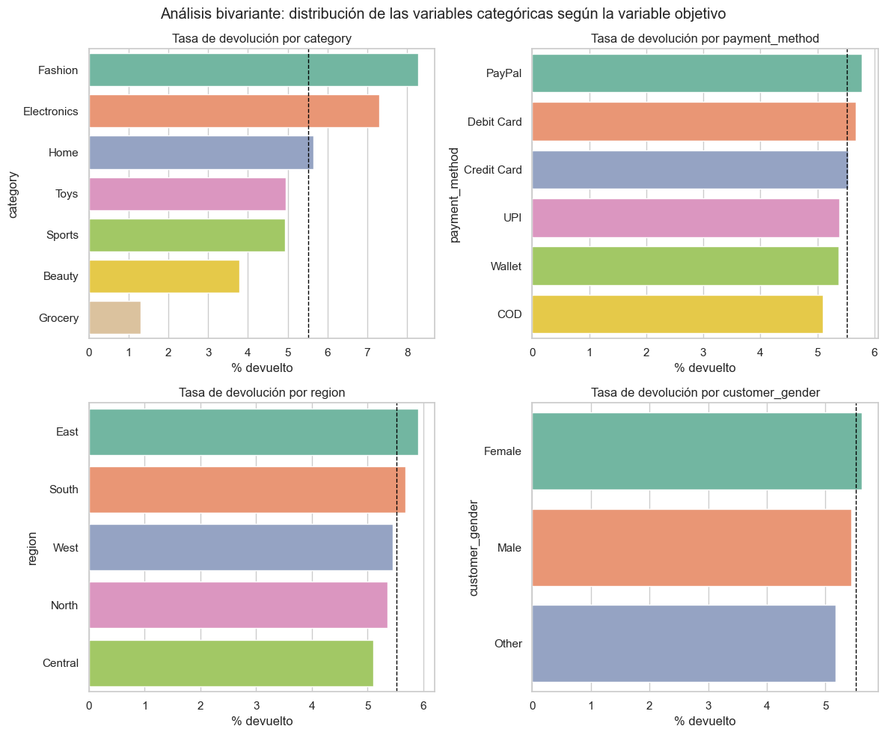
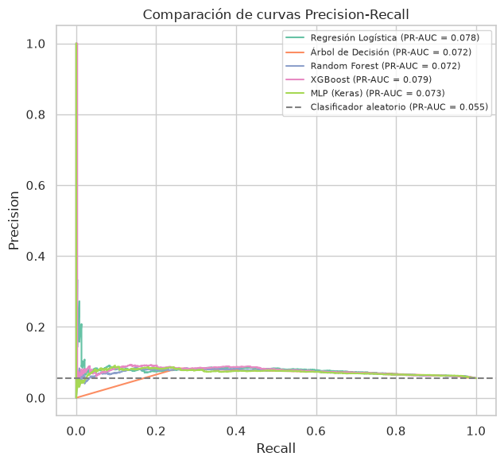
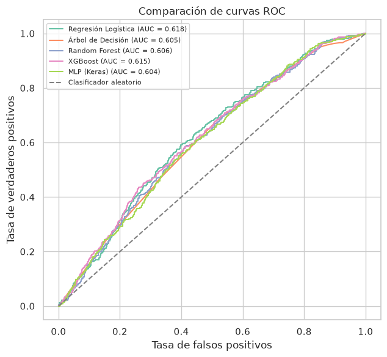
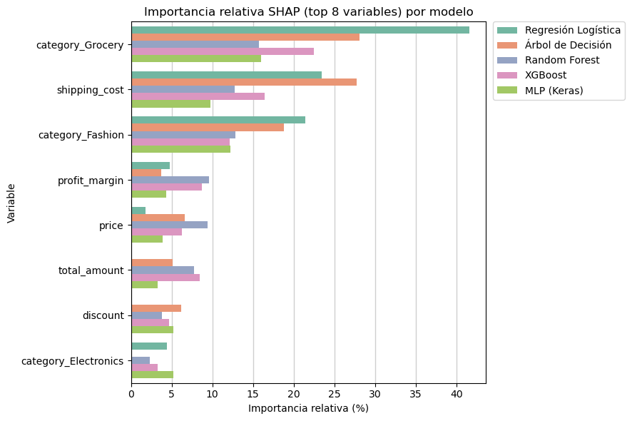
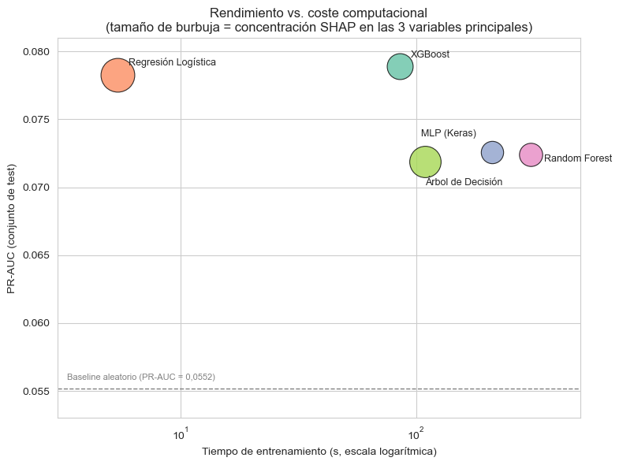
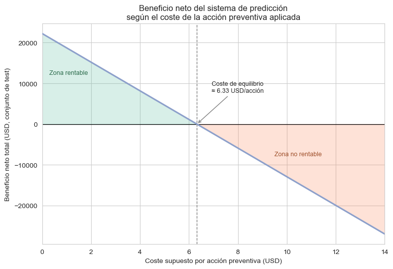

# Detección de pedidos con alta probabilidad de devolución y aplicación de medidas preventivas

**Trabajo Fin de Máster — Máster Universitario en Inteligencia Artificial**
Universidad Internacional de Valencia (VIU) · Curso 2025–2026 · Convocatoria de septiembre de 2026

| | |
|---|---|
| **Autor** | Marcos Quintas Pérez |
| **Directora** | Mónica Díaz Hernández |
| **Documentación** | [`docs/RESUMEN_TFM.md`](docs/RESUMEN_TFM.md): resumen detallado de la memoria |

---

## Índice

1. [Resumen](#resumen)
2. [Objetivos](#objetivos)
3. [Estructura del repositorio](#estructura-del-repositorio)
4. [Dataset](#dataset)
5. [Metodología](#metodología)
6. [Resultados](#resultados)
7. [Cómo reproducir el trabajo](#cómo-reproducir-el-trabajo)
8. [Entorno y librerías](#entorno-y-librerías)
9. [Limitaciones y trabajo futuro](#limitaciones-y-trabajo-futuro)
10. [Documentación adicional](#documentación-adicional)
11. [Cita](#cita)

---

## Resumen

Las altas tasas de devolución son uno de los mayores retos operativos y económicos del comercio electrónico, especialmente en sectores como la moda. Elevan los costes logísticos, complican la gestión del inventario y tienen un impacto medioambiental por la logística inversa. Anticipar qué pedidos tienen más probabilidad de devolverse permite aplicar **medidas preventivas** antes de que la devolución ocurra.

Este TFM desarrolla un **sistema de detección temprana de devoluciones** basado en aprendizaje supervisado que combina tres piezas:

1. **Predicción**: se entrenan y comparan cinco clasificadores (Regresión Logística, Árbol de Decisión, Random Forest, XGBoost y una red neuronal densa MLP).
2. **Interpretabilidad (XAI)**: se explican las predicciones de cada modelo con **valores SHAP**.
3. **Impacto económico**: se estima el ahorro potencial y el **coste de equilibrio** de las acciones preventivas aplicadas a los pedidos marcados por el modelo.

> El valor del trabajo está en la combinación **predicción + SHAP + impacto económico**, más que en la capacidad predictiva absoluta, que es modesta debido a la débil señal del dataset.

---

## Objetivos

| ID | Objetivo específico | Notebook |
|----|---------------------|----------|
| OE1 | Análisis exploratorio y preprocesamiento del dataset | [`TFM_01_EDA_Preprocesado`](notebooks/TFM_01_EDA_Preprocesado.ipynb) |
| OE2 | Desarrollo y evaluación de modelos de clasificación supervisada | [`TFM_02_Modelado`](notebooks/TFM_02_Modelado.ipynb) |
| OE3 | Identificación de variables influyentes mediante XAI (SHAP) | [`TFM_03_SHAP`](notebooks/TFM_03_SHAP.ipynb) |
| OE4 | Comparación de modelos y selección del óptimo | [`TFM_04_SeleccionModelo`](notebooks/TFM_04_SeleccionModelo.ipynb) |
| OE5 | Estimación del impacto económico potencial | [`TFM_05_ImpactoEconomico`](notebooks/TFM_05_ImpactoEconomico.ipynb) |

---

## Estructura del repositorio

```
Trabajo_Fin_Master_VIU_2/
├── README.md
├── requirements.txt              # Librerías y versiones utilizadas
├── .gitignore
│
├── docs/
│   └── RESUMEN_TFM.md            # Resumen detallado de la memoria (contexto, decisiones y discusión)
│
├── notebooks/                    # Flujo completo del trabajo, en orden de ejecución
│   ├── TFM_01_EDA_Preprocesado.ipynb  # EDA, preprocesado y split train/test
│   ├── TFM_02_Modelado.ipynb          # Entrenamiento, ajuste de hiperparámetros y evaluación
│   ├── TFM_03_SHAP.ipynb              # Interpretabilidad con valores SHAP
│   ├── TFM_04_SeleccionModelo.ipynb   # Rendimiento vs. coste vs. interpretabilidad
│   └── TFM_05_ImpactoEconomico.ipynb  # Ahorro bruto y coste de equilibrio
│
├── data/                         # Dataset (no versionado, ver data/README.md)
│   └── README.md
│
├── modelos/                      # Modelos entrenados (mejores hiperparámetros)
│   ├── logistic_regression.joblib     # Modelo seleccionado
│   ├── decision_tree.joblib
│   ├── random_forest.joblib
│   ├── xgboost_model.joblib
│   ├── mlp_keras.keras
│   └── README.md
│
├── resultados/                   # Tablas de resultados generadas por los notebooks
│   ├── tabla_comparativa_modelos.csv
│   └── shap_importancia_top8.csv
│
└── figuras/                      # Figuras generadas por los notebooks
    ├── eda/
    ├── modelado/
    ├── shap/
    ├── seleccion/
    └── impacto_economico/
```

Los notebooks usan rutas relativas a la carpeta `notebooks/` (`../data`, `../modelos`, `../figuras`, `../resultados`), así que se ejecutan directamente desde ahí.

---

## Dataset

Se utiliza el dataset sintético de Kaggle [E-commerce Sales Transactions Dataset](https://www.kaggle.com/datasets/miadul/e-commerce-sales-transactions-dataset) (`ecommerce_sales_34500.csv`):

- **34.500 pedidos**, 16 variables y una variable objetivo binaria `returned` (Yes / No).
- **Fuerte desbalanceo**: 94,48 % no devueltos frente a **5,52 % devueltos**.
- Sin valores nulos ni duplicados.

| Tipo | Variables |
|------|-----------|
| Numéricas | `price`, `discount`, `quantity`, `delivery_time_days`, `total_amount`, `shipping_cost`, `profit_margin`, `customer_age` |
| Categóricas | `category` (7), `payment_method` (6), `region` (5), `customer_gender` (3) |
| Descartadas | `order_id`, `customer_id`, `product_id` (identificadores), `order_date` |
| Objetivo | `returned` |

El CSV no se incluye en el repositorio: descárgalo desde [E-commerce Sales Transactions Dataset](https://www.kaggle.com/datasets/miadul/e-commerce-sales-transactions-dataset) y guárdalo como `data/ecommerce_sales_34500.csv` (más detalles en [`data/README.md`](data/README.md)).

<p align="center">
  
</p>

`category` es la única variable categórica cuya tasa de devolución se aleja claramente de la media (Fashion devuelve mucho más), y `shipping_cost` es la numérica con mayor diferencia entre pedidos devueltos y no devueltos.

---

## Metodología

### 1. EDA y preprocesado (`TFM_01`)
- Análisis univariante y bivariante, correlaciones, test χ² para categóricas y detección de atípicos (regla 1,5·IQR).
- Eliminación de identificadores y de `order_date`.
- **Split estratificado** 80/20 (`random_state=42`): 27.600 pedidos de entrenamiento y 6.900 de test.
- `OneHotEncoder(drop="first")` para categóricas y `StandardScaler` para numéricas, ajustados solo sobre train → **25 variables** finales.

### 2. Modelado (`TFM_02`)
- Validación cruzada estratificada (`StratifiedKFold`) con búsqueda de hiperparámetros (`GridSearchCV` / `RandomizedSearchCV`).
- **Métrica de selección: PR-AUC** (`scoring="average_precision"`), la más sensible a la clase minoritaria. También se reportan Recall, F1, F2 y ROC-AUC.
- Desbalanceo tratado con pesos de clase: `class_weight="balanced"` en los modelos de scikit-learn y Keras, y `scale_pos_weight` en XGBoost.

| Modelo | Búsqueda | Combinaciones | CV | Mejores hiperparámetros |
|--------|----------|:---:|:---:|------------------------|
| Regresión Logística | GridSearchCV | 12 | 5 | `C=0.01`, `penalty="l1"` |
| Árbol de Decisión | GridSearchCV | 144 | 5 | `criterion="entropy"`, `max_depth=5`, `min_samples_leaf=10`, `min_samples_split=2` |
| Random Forest | RandomizedSearchCV | 12 | 5 | `n_estimators=200`, `max_depth=10`, `min_samples_leaf=5`, `max_features="sqrt"` |
| XGBoost | RandomizedSearchCV | 25 | 5 | `n_estimators=300`, `max_depth=6`, `learning_rate=0.01`, `min_child_weight=5`, `gamma=0.1`, `colsample_bytree=0.6` |
| MLP (Keras) | RandomizedSearchCV | 8 | 3 | 1 capa oculta de 32 neuronas (ReLU), `dropout=0.0`, `learning_rate=0.001` |

### 3. Interpretabilidad SHAP (`TFM_03`)
- Un explicador adecuado a cada familia de modelo: `LinearExplainer` (Regresión Logística), `TreeExplainer` (Árbol, Random Forest y XGBoost) y `DeepExplainer` (MLP), con 100 observaciones de fondo cuando el explicador las necesita.
- Importancia global de variables por modelo (*summary plots*) y comparación de la importancia relativa (% del total de |SHAP|) entre modelos.

### 4. Selección del modelo (`TFM_04`)
Se combinan tres criterios: **rendimiento** (PR-AUC, Recall), **coste computacional** (tiempo de entrenamiento) e **interpretabilidad** (concentración SHAP en las 3 variables principales).

### 5. Impacto económico (`TFM_05`)

$$\text{Beneficio neto}(c) = 0{,}30 \times \sum_{VP} \text{total\_amount} \;-\; c \times (N_{VP} + N_{FP})$$

- El primer término es el **ahorro bruto**: el 30 % del importe de los pedidos devueltos detectados a tiempo (verdaderos positivos).
- El segundo término es el **coste de las acciones preventivas** (`c` por pedido), que se aplica a todos los pedidos marcados, sean VP o FP.

---

## Resultados

### Comparación de modelos (conjunto de test)

| Modelo | Accuracy | Precision | Recall | F1 | F2 | ROC-AUC | **PR-AUC** | Tiempo (s) |
|--------|:---:|:---:|:---:|:---:|:---:|:---:|:---:|:---:|
| XGBoost | 0,5954 | 0,0760 | 0,5669 | 0,1340 | 0,2473 | 0,6150 | **0,0789** | 85,2 |
| **Regresión Logística** | 0,5103 | 0,0737 | **0,6798** | 0,1329 | **0,2569** | **0,6179** | 0,0783 | **5,4** |
| MLP (Keras) | 0,5803 | 0,0739 | 0,5722 | 0,1309 | 0,2436 | 0,6043 | 0,0726 | 211,0 |
| Random Forest | 0,7396 | 0,0806 | 0,3570 | 0,1315 | 0,2117 | 0,6064 | 0,0724 | 306,6 |
| Árbol de Decisión | 0,5016 | 0,0719 | 0,6745 | 0,1300 | 0,2522 | 0,6051 | 0,0719 | 109,0 |

Todos los modelos mejoran el *baseline* aleatorio (PR-AUC = 0,0552) entre **1,3 y 1,43 veces**. Es una mejora real pero modesta, coherente con las débiles correlaciones del dataset.

<p align="center">
  
  
</p>

### Interpretabilidad SHAP

Las tres variables más influyentes coinciden en **todos** los modelos: `category_Grocery`, `shipping_cost` y `category_Fashion`. Lo que cambia es cuánta importancia concentran:

| Variable (% del total \|SHAP\|) | Reg. Logística | Árbol | Random Forest | XGBoost | MLP |
|---|:---:|:---:|:---:|:---:|:---:|
| `category_Grocery` | 41,55 | 28,12 | 15,68 | 22,43 | 15,96 |
| `shipping_cost` | 23,46 | 27,74 | 12,59 | 16,46 | 9,74 |
| `category_Fashion` | 21,42 | 18,79 | 12,62 | 12,12 | 12,18 |
| **Top-3 acumulado** | **86,43** | 74,65 | 40,89 | 51,01 | 37,88 |

<p align="center">
  
</p>

### Selección del modelo: Regresión Logística

<p align="center">
  
</p>

La diferencia de PR-AUC entre XGBoost y la Regresión Logística es de solo **0,0006**. La Regresión Logística, en cambio:

- tiene el **Recall más alto** (0,68), el más alineado con el objetivo de negocio de no dejar escapar devoluciones;
- es la **más rápida** de entrenar (5,4 s frente a 85,2 s de XGBoost);
- es la **más interpretable** (86 % de la señal SHAP en 3 variables).

**Conclusión:** en este problema, los modelos más complejos no aportan una ventaja real.

### Impacto económico (Regresión Logística, 6.900 pedidos de test)

| Resultado | N pedidos | Σ total_amount (USD) |
|-----------|:---:|---:|
| VP (devolución detectada a tiempo) | 259 | 74.135,69 |
| FN (devolución no detectada) | 122 | 13.091,27 |
| FP (falsa alarma) | 3.257 | 882.438,50 |
| VN (acierto, no devuelto) | 3.262 | 188.338,77 |

| Indicador | Valor |
|-----------|------:|
| Ahorro bruto potencial (30 % × Σ VP) | **22.240,71 USD** |
| Pedidos marcados (VP + FP) | 3.516 |
| **Coste de equilibrio por acción preventiva** | **6,33 USD** |
| Oportunidad perdida por FN (30 % × Σ FN) | 3.927,38 USD |

<p align="center">
  
</p>

El sistema es rentable siempre que cada acción preventiva cueste menos de **6,33 USD por pedido marcado**. Esta cifra se calcula sobre el conjunto de test; para una estimación a escala de negocio hay que extrapolarla al volumen real de pedidos.

---

## Cómo reproducir el trabajo

```bash
# 1. Clonar el repositorio
git clone https://github.com/Markint86/Trabajo_Fin_Master_VIU_2.git
cd Trabajo_Fin_Master_VIU_2

# 2. Crear un entorno e instalar dependencias (Python 3.13)
python -m venv .venv
source .venv/bin/activate          # Windows: .venv\Scripts\activate
pip install -r requirements.txt

# 3. Descargar el dataset de Kaggle y guardarlo como data/ecommerce_sales_34500.csv
#    https://www.kaggle.com/datasets/miadul/e-commerce-sales-transactions-dataset

# 4. Ejecutar los notebooks en orden desde la carpeta notebooks/
jupyter lab notebooks/
```

| Orden | Notebook | Entradas | Salidas |
|:---:|----------|----------|---------|
| 1 | `TFM_01_EDA_Preprocesado` | `data/ecommerce_sales_34500.csv` | `data/X_train_proc.csv`, `X_test_proc.csv`, `y_train.csv`, `y_test.csv`, `figuras/eda/` |
| 2 | `TFM_02_Modelado` | CSV procesados | `modelos/*`, `resultados/tabla_comparativa_modelos.csv`, `figuras/modelado/` |
| 3 | `TFM_03_SHAP` | CSV procesados + `modelos/*` | `resultados/shap_importancia_top8.csv`, `figuras/shap/` |
| 4 | `TFM_04_SeleccionModelo` | Métricas de los notebooks 02 y 03 (introducidas en el código) | `figuras/seleccion/` |
| 5 | `TFM_05_ImpactoEconomico` | CSV original + `modelos/logistic_regression.joblib` | `figuras/impacto_economico/` |

> Para usar los 5 modelos ya entrenados de `modelos/` sin reentrenar, basta con ejecutar el notebook 01 (para generar los CSV procesados) y después el 03, el 04 o el 05.

### Cargar el modelo seleccionado

```python
import joblib
modelo = joblib.load("modelos/logistic_regression.joblib")
# X debe tener las 25 columnas preprocesadas (OneHot + StandardScaler) del notebook 01
proba_devolucion = modelo.predict_proba(X)[:, 1]
```

---

## Entorno y librerías

Desarrollado con **Python 3.13.9** (Anaconda) en Jupyter. Librerías principales:

| Librería | Versión | Uso |
|----------|---------|-----|
| numpy | 2.4.6 | Cálculo numérico |
| pandas | 3.0.3 | Manipulación de datos |
| scipy | 1.17.1 | Test χ² de independencia |
| scikit-learn | 1.8.0 | Preprocesado, modelos clásicos, búsqueda de hiperparámetros y métricas |
| xgboost | 3.4.1 | Modelo XGBoost |
| tensorflow / keras | 2.21.0 / 3.15.1 | Red neuronal densa (MLP) |
| scikeras | 0.13.0 | Envoltorio de Keras para `RandomizedSearchCV` |
| shap | 0.52.0 | Interpretabilidad |
| matplotlib / seaborn | 3.10.9 / 0.13.2 | Visualización |
| joblib | 1.5.3 | Serialización de modelos |

> **Nota de versiones:** los modelos `.joblib` se serializaron con **scikit-learn 1.5.2**. Si se cargan con otra versión, scikit-learn muestra un `InconsistentVersionWarning`. Las predicciones del notebook 05 se obtuvieron así y coinciden con las de la memoria, pero para una carga sin avisos se puede usar `scikit-learn==1.5.2`.

---

## Limitaciones y trabajo futuro

- **Dataset sintético**: no se pudo validar con datos reales de una empresa, así que los resultados podrían no generalizar.
- **Señal predictiva débil**: ningún modelo supera un PR-AUC de 0,0789 frente al 0,0552 del baseline.
- **Sin historial del cliente**: faltan variables de comportamiento previo (por ejemplo, devoluciones anteriores), que en la literatura son muy predictivas.
- **Modelo económico simplificado**: ahorro fijo del 30 % y coste uniforme `c` por acción, sin diferenciar por categoría ni por nivel de riesgo.
- **MLP**: por limitaciones de tiempo y cómputo, su entrenamiento no llegó a estabilizarse del todo.

Como trabajo futuro se propone validar el sistema con datos reales que incluyan información de comportamiento del cliente y del producto, y usar costes de acción diferenciados por segmento de riesgo.

---

## Documentación adicional

La memoria completa del TFM no se publica. [`docs/RESUMEN_TFM.md`](docs/RESUMEN_TFM.md) recoge su contenido de forma resumida pero detallada: motivación, estado del arte, decisiones de preprocesado, comportamiento de cada modelo, discusión SHAP, modelo económico, conclusiones y referencias.

---

## Cita

```bibtex
@mastersthesis{quintas2026devoluciones,
  author = {Quintas P{\'e}rez, Marcos},
  title  = {Detecci{\'o}n de pedidos con alta probabilidad de devoluci{\'o}n y aplicaci{\'o}n de medidas preventivas},
  school = {Universidad Internacional de Valencia (VIU)},
  type   = {Trabajo Fin de M{\'a}ster, M{\'a}ster Universitario en Inteligencia Artificial},
  year   = {2026},
  month  = {sep}
}
```
